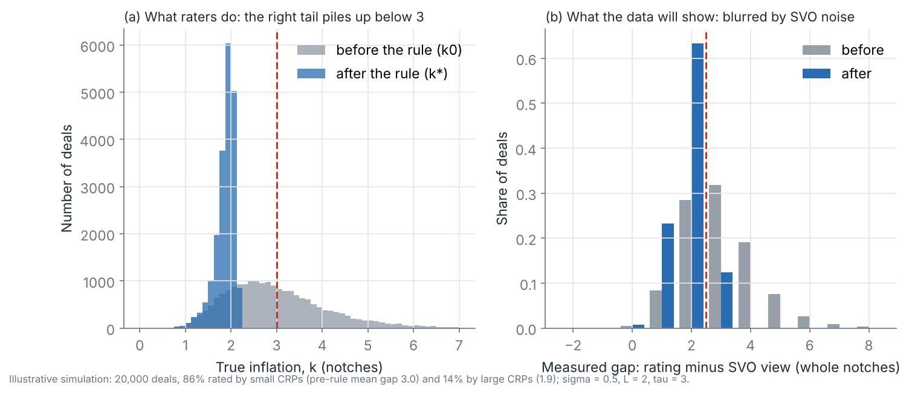

# Challenge rights over private ratings

A largely theoretical, lightly calibrated paper. Target journal: *Journal of Financial Stability*.

**Question.** US insurers can set their capital using private letter ratings bought from small agencies. From 2026 the NAIC's Securities Valuation Office (SVO) can challenge a rating that sits 3 or more notches above its own view. How does that threat change the ratings agencies give, and how should the rule be designed?

**Start here:** [docs/MODEL_PLAN.md](docs/MODEL_PLAN.md). It builds the model from scratch with diagrams.
Interactive version with sliders: [Challenge Rights Model](https://claude.ai/artifact/9FmMfgm2mXy6kL37GmzxRK) (source in `docs/explainer.html`).



## Layout
```
docs/
  MODEL_PLAN.md          the model, brick by brick, and the build plan
  figures/               figures used in the plan (made by model/make_figures.py)
  explainer.html         source of the interactive primer
  background/            institutional Q&A (NAIC, SVO, the rule) and the literature review
model/
  core.py                baseline model: payoff, optimal inflation, simulation of many deals
  make_figures.py        regenerates docs/figures/
data/
  rbc_factors_life.csv   capital charge per NAIC designation
  calibration_targets.csv  published numbers to match
  README.md              data sources: what is free, what must be bought
literature/
  CATALOGUE.csv          36 papers with one line on why each matters here
  papers/                PDFs in six folders (private repo: do not make public)
```

## Run
```
cd model
python3 make_figures.py      # needs numpy, scipy, pandas, matplotlib
```

## Rules for this repo
- Keep the repo private: `literature/papers/` holds copyrighted PDFs.
- No PhD bank-panel data or results derived from it.
- Do not post drafts to SSRN without Laurence's say-so.
