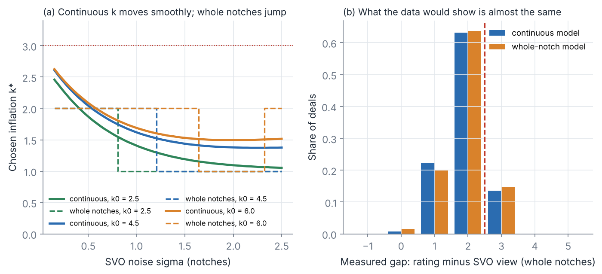
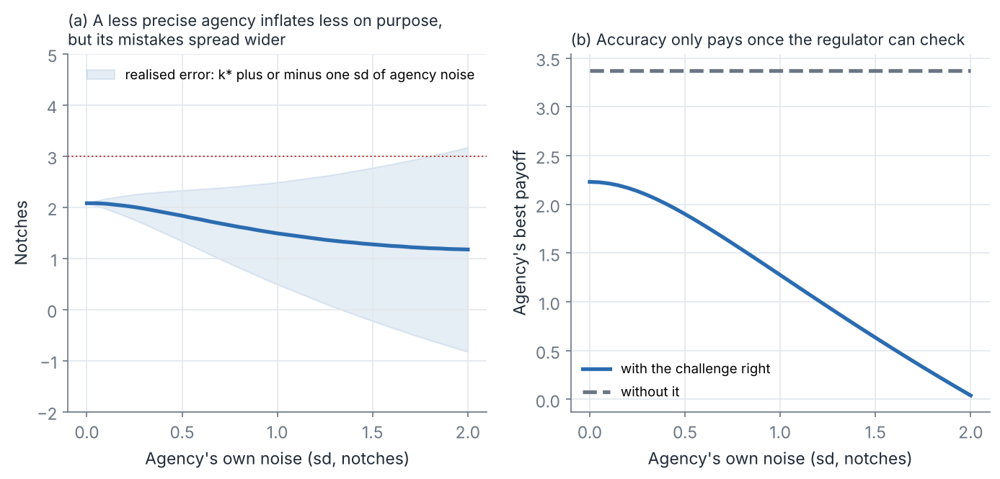

# Modelling choices

*16 Oct 2026. Figures made by `model/decision_figures.py`.*

## Decided
- **Language:** Julia for the solver (Laurence, 16 Oct). The baseline is ported in `model/julia/ChallengeModel.jl` and matches the Python prototype (`check_against_python.jl`). Python stays for figures for now.

## Agreed 16 Oct: continuous inflation in the theory, whole notches in simulations

- **What changes in the theory (panel a).** With continuous k the agency's choice moves smoothly as the SVO's noise σ changes, so every result is a clean derivative ("k* falls as σ rises"). With whole notches k* jumps between 1 and 2 and can even move back up. Proofs then need case-by-case comparisons, and some comparative statics only hold "weakly".
- **What changes in the predictions (panel b).** Almost nothing. Measured gaps are whole notches either way, because the SVO's view is rounded too. Both versions predict the same spike at 2 and missing mass at 3 and above.
- **Recommendation:** continuous in the theory, whole notches in the simulations and calibration. This is standard in the rating-theory literature, and the paper can show panel (b) to make the point that nothing hinges on it.

## Agreed 16 Oct: hold agency precision, add it as Stage 2b

Here the agency no longer knows true quality exactly. It sees θ plus its own error (sd shown on the x-axis), then adds k.

- **Panel (a).** A less precise agency inflates less on purpose, because its own mistakes could push it over the line by accident. Its realised errors spread wider, though, including some ratings that are too low.
- **Panel (b).** Without the challenge right, accuracy is worth nothing to the agency (flat dashed line). With it, every notch of noise costs the agency. **So the challenge right is what makes accuracy pay.** That could be a second headline result, and it links straight to π in Paper 1.
- **If precision is fixed (not chosen),** it behaves much like extra SVO noise and adds little. The value comes from letting the agency *choose* its precision at a cost.
- **Recommendation:** hold it until the Stage 1 proofs are done, then add it as its own stage (Stage 2b: the agency chooses precision). Adding it now would turn every Stage 1 proof into a two-choice problem before the basic result is pinned down.
