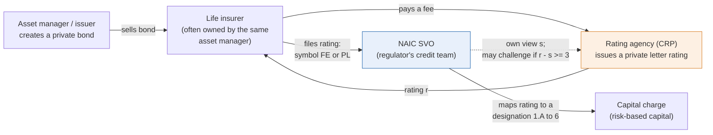
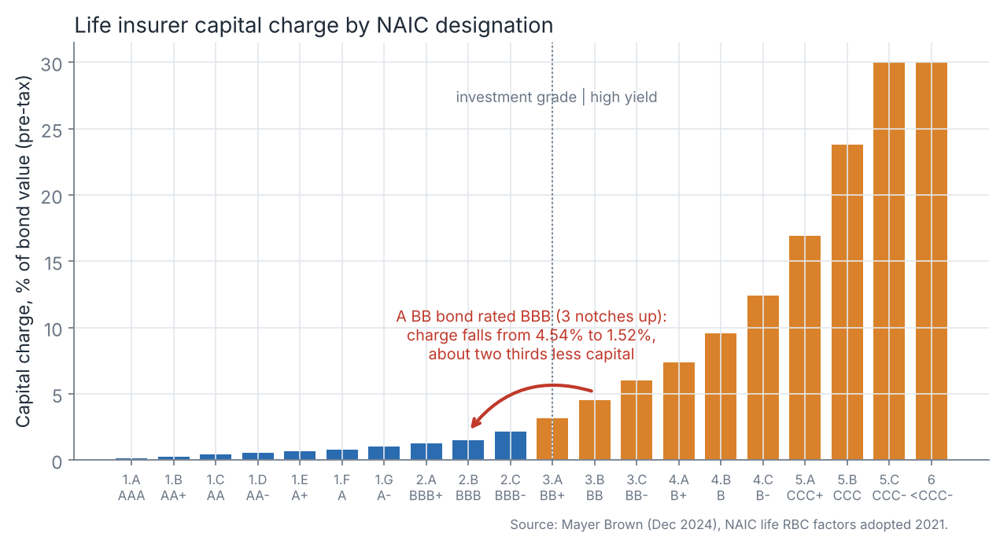
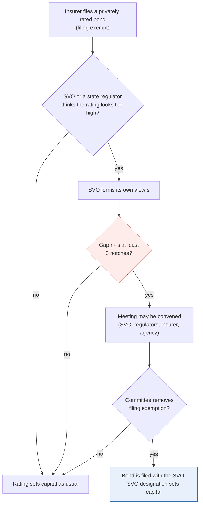
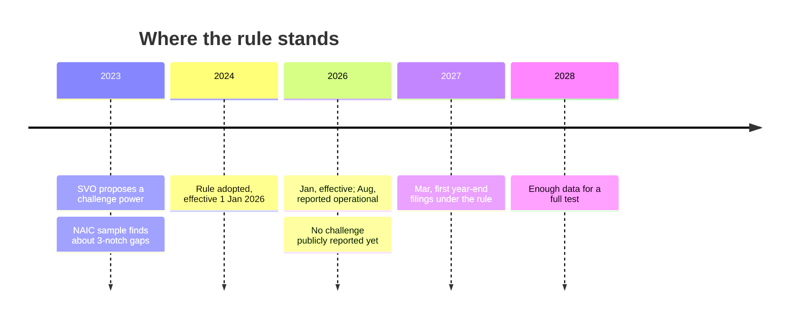
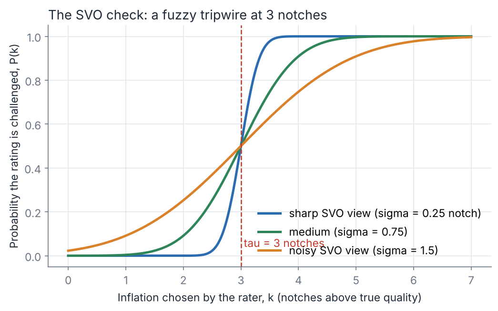
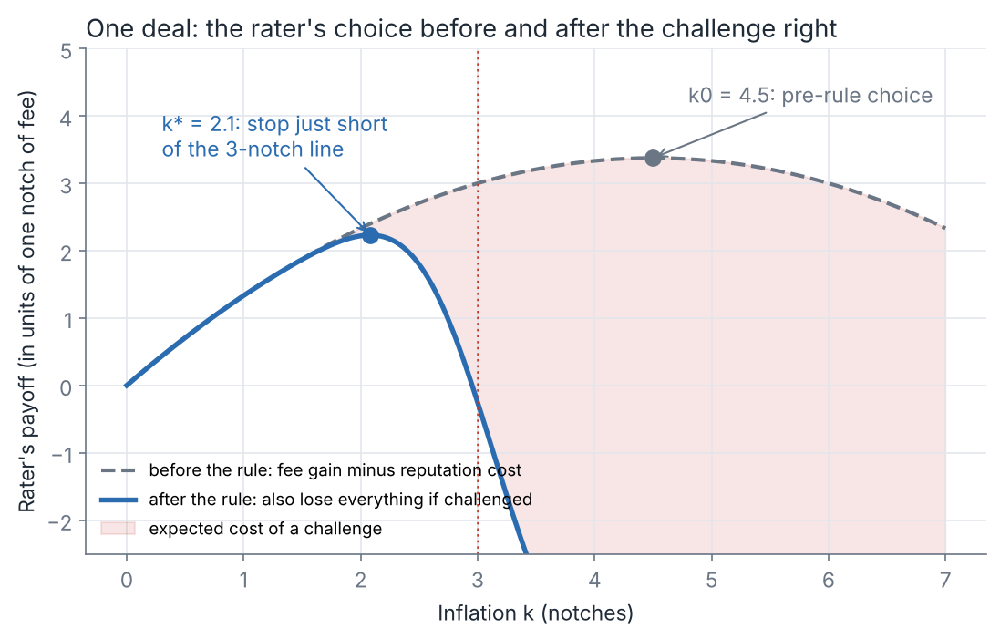
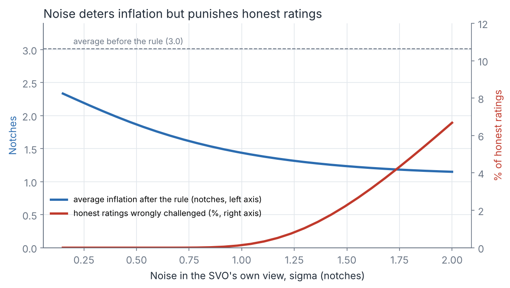
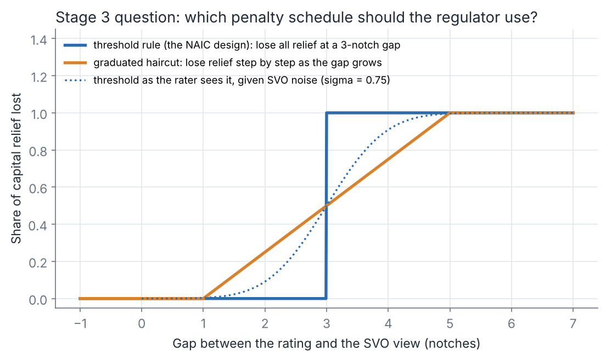
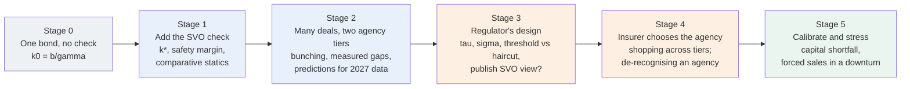

# Model plan: challenge rights over private ratings

*Draft of 16 Oct 2026. It starts from zero and adds one brick at a time. Every number in the figures comes from `model/core.py`, and the parameter values are illustrative until we calibrate them (Stage 5).*

**The question in one sentence.** US insurers can set their capital using ratings bought privately from small agencies. Since 2026 the regulator can challenge a rating that is 3 or more notches above its own view. How does that threat change the ratings agencies give, and what is the best way to design it?

---

## 1. Who is in the story



- **The insurer wants a high rating,** because a higher rating means less capital.
- **Normally a buyer wants an honest rating.** Here the buyer is the insurer, and it gains from inflation. Nobody on the private side pushes back.
- **The only outside check is the SVO,** the NAIC's own credit team. The 2026 rule lets it question a rating that sits 3 or more notches above its own view.

## 2. Why one notch is worth real money



The capital charge more than doubles every three notches, and the steps get bigger further down the scale. A rating agency that lifts a BB bond to BBB cuts the insurer's capital on it by about two thirds. This is the "benefit of inflation" in the model.

## 3. Public bonds have a referee, private bonds do not

| | Public bond | Private bond with a private rating |
|---|---|---|
| Who sees the rating | Everyone | The insurer and the regulator |
| Market price that can contradict it | Yes, trades daily | No, rarely trades |
| Who wants an accurate rating | Investors | Nobody on the private side |
| What disciplines the rater | Prices, reputation, lawsuits | Only the SVO's check (from 2026) |

This is why private ratings drift up. In the NAIC's 2023 sample, 106 of 109 private ratings sat above the SVO's view. The average gap was about 3 notches for small agencies and 1.9 for large ones.

## 4. The rule, step by step





---

## 5. Building the model, brick by brick

### Brick 1: true quality and the rating

Each bond has a **true credit quality** $\theta$, measured on the notch scale. The agency knows $\theta$ and reports

$$r = \theta + k,\qquad k \ge 0 .$$

$k$ is **inflation in notches**. An honest rating has $k = 0$. Choosing $k$ is the agency's only decision.

```
true quality θ          rating r = θ + k
     BB                     BBB
 ─────●──────────────────────●──────────►  better credit
      └──────── k = 3 notches ┘
```

### Brick 2: the SVO's noisy view

The SVO does its own analysis, but it is not perfect. Its view is

$$s = \theta + \varepsilon,\qquad \varepsilon \sim N(0,\sigma^2).$$

$\sigma$ is the **SVO's noise**, in notches. Private deals are thin and unusual, so $\sigma$ is not small. The gap the SVO measures is $g = r - s = k - \varepsilon$. A challenge happens when $g \ge \tau = 3$, and it is upheld with probability $q$. So the chance that a rating with inflation $k$ is challenged is

$$P(k) = q\,\Phi\!\left(\frac{k-\tau}{\sigma}\right).$$



- **A sharp SVO** (small $\sigma$) acts like a hard tripwire at 3 notches.
- **A noisy SVO** spreads the risk. It sometimes catches a 1-notch rating and sometimes misses a 5-notch one.

### Brick 3: the agency's payoff

$$U(k) \;=\; \underbrace{b\,k\,\bigl(1-P(k)\bigr)}_{\text{fee gain, kept only if not challenged}} \;-\; \underbrace{L\,P(k)}_{\text{penalty if challenged}} \;-\; \underbrace{\tfrac{\gamma}{2}k^2}_{\text{reputation and other costs}}$$

| Symbol | Meaning | Real-world counterpart |
|---|---|---|
| $b$ | value to the agency of one notch | share of the insurer's capital saving that the agency captures through fees and repeat business |
| $L$ | loss if a challenge is upheld | lost client, scrutiny from the new CRP Working Group, risk of losing NAIC recognition |
| $\gamma$ | everyday cost of inflating | reputation with other users, internal standards; higher for large agencies |
| $\tau$ | challenge threshold | 3 notches in the NAIC rule |
| $\sigma$ | SVO noise | how hard the deal is for the SVO to assess |
| $q$ | chance a challenge is upheld | committee discretion |

**Before the rule** ($P = 0$) the agency picks $k_0 = b/\gamma$. We calibrate this to the observed pre-rule gaps.

**After the rule** the agency picks $k^*$ where the extra fee from one more notch equals the extra expected loss from being caught:

$$b\,(1-P(k^*)) \;=\; (b\,k^* + L)\,P'(k^*) + \gamma k^* .$$



In the figure the agency would inflate 4.5 notches without the rule. With it, the agency stops at about 2 notches, leaving a safety margin below the 3-notch line.

### Brick 4: many deals, two kinds of agency

Deals differ in how much inflation is worth ($b$ varies). Agencies differ too: small agencies (86% of private ratings) have a lower everyday cost $\gamma$ than large ones.


- **Panel (a), what agencies do.** The right tail is cut off. Deals that would have been rated 3 to 6 notches too high pile up just below 3. This pile is called **bunching**.
- **Panel (b), what the data will show.** We only see the gap against the SVO's noisy view, in whole notches. The pile shows up as a spike at 2 and missing mass at 4 and above. The width of the blur tells us $\sigma$.
- **Tiers converge.** In this simulation the gap between small and large agencies falls from 1.15 notches before the rule to 0.26 after, because the rule bites mostly on the small agencies' right tail.

### Brick 5: the noise trade-off



Two forces pull against each other.
- **A sharper SVO lets agencies sit closer to the line.** With a precise check, inflating to 2.5 notches is safe. Average inflation is therefore *higher* when $\sigma$ is small.
- **A noisier SVO deters more but hits the innocent.** It scares agencies from far away, but it also challenges honest ratings, and that cost falls on legitimate private credit.

This tension is the heart of the design question.

---

## 6. The design question (Stage 3)



The regulator chooses a **penalty schedule**: how much capital relief a bond loses as its measured gap grows.
- **Threshold (the NAIC rule):** nothing below 3 notches, everything at 3.
- **Graduated haircut:** relief falls step by step as the gap grows.

With noise the threshold already looks smooth to the agency (dotted line). So the question is which shape gives the best balance between three costs:

$$W = -\lambda\,\underbrace{E[\text{inflation left uncaught}]}_{\text{capital shortfall}} \;-\; \kappa\,\underbrace{E[\text{honest bonds penalised}]}_{\text{lost access to private credit}} \;-\; c_R\,\underbrace{E[\text{reviews}]}_{\text{SVO workload}}$$

**Working hypothesis, not yet proved:** a threshold does better when the SVO is noisy, and a graduated haircut does better when it is precise. Stage 3 checks this.

---

## 7. The build plan



| Stage | What we add | What we get out | Status |
|---|---|---|---|
| 0 | One agency, one bond, no check | Inflation $k_0 = b/\gamma$; link to Opp–Opp–Harris | sketched (this note) |
| 1 | SVO view with noise $\sigma$, threshold $\tau$, penalty $L$ | Optimal $k^*$; proof it sits below $\tau$; how $k^*$ moves with $\sigma$, $\tau$, $L$ | numbers done, proofs next |
| 2 | Many deals; small and large agencies | Bunching and the measured-gap distribution; tier gap shrinks | simulated (Fig. 4) |
| 3 | Regulator's welfare $W$ | Best $\tau$; threshold vs haircut; value of publishing the SVO view | next |
| 4 | Insurer picks small or large agency; agency-level recognition | Shopping; rating-level challenge vs agency-level eligibility | later |
| 5 | Calibration to the targets in `data/calibration_targets.csv` | Capital shortfall; downturn scenario with many removals at once | later |

## 8. How this connects to your Paper 1 model

| Paper 1 | This paper | What changes |
|---|---|---|
| Posture (Lenient, Honest, Conservative) | Inflation $k$, a continuous choice | Posture becomes "how many notches" |
| Verification $d$, a constant | $P(k)$, rising with the size of the error | Verification now depends on how big the lie is |
| Penalty $\chi$ on optimistic errors | $L$ plus loss of capital relief | The penalty is triggered by a regulator, not a default |
| Precision $\pi$ | SVO noise $\sigma$ (and later agency precision) | Precision now sits with the checker |

## 9. Predictions we can test when the 2026 filings arrive

1. **Bunching below 3 notches:** fewer private ratings 3 or more notches above comparable views, and more at 1 to 2.
2. **Tier convergence:** the gap between small and large agencies narrows.
3. **Hard-to-assess deals:** where $\sigma$ is high (complex structured deals), inflation falls more but false challenges rise.
4. **Shopping (Stage 4):** after the rule, some deals move to agencies with the lowest penalty $L$.

## 10. Decisions for you

1. **Agency information.** In the baseline the agency knows $\theta$ exactly. We can add agency precision $\pi$ from Paper 1 in Stage 4. I suggest waiting.
2. **Continuous vs whole notches.** The baseline uses continuous $k$. Whole notches make the bunching sharper but the proofs messier. I suggest staying continuous and using whole notches only in simulations.
3. **Code language.** The prototype is in Python because that is what this environment has. The final solver can move to Julia or R if you prefer.
