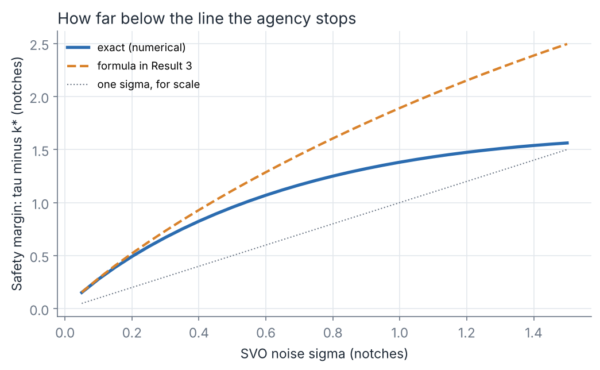
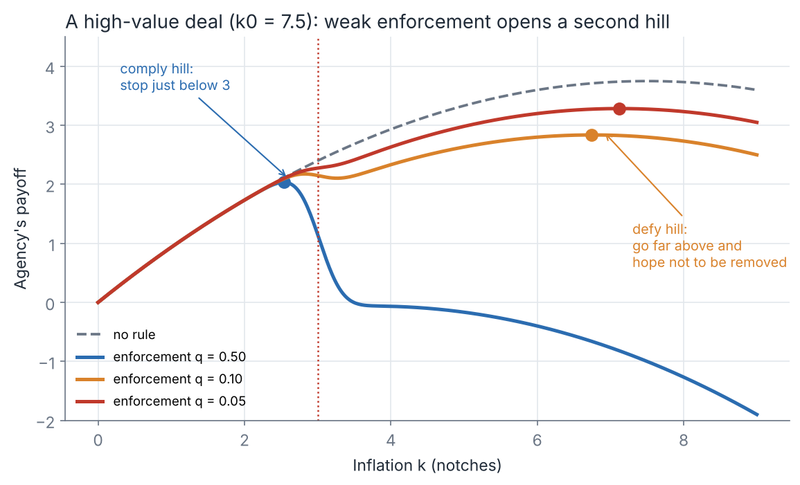
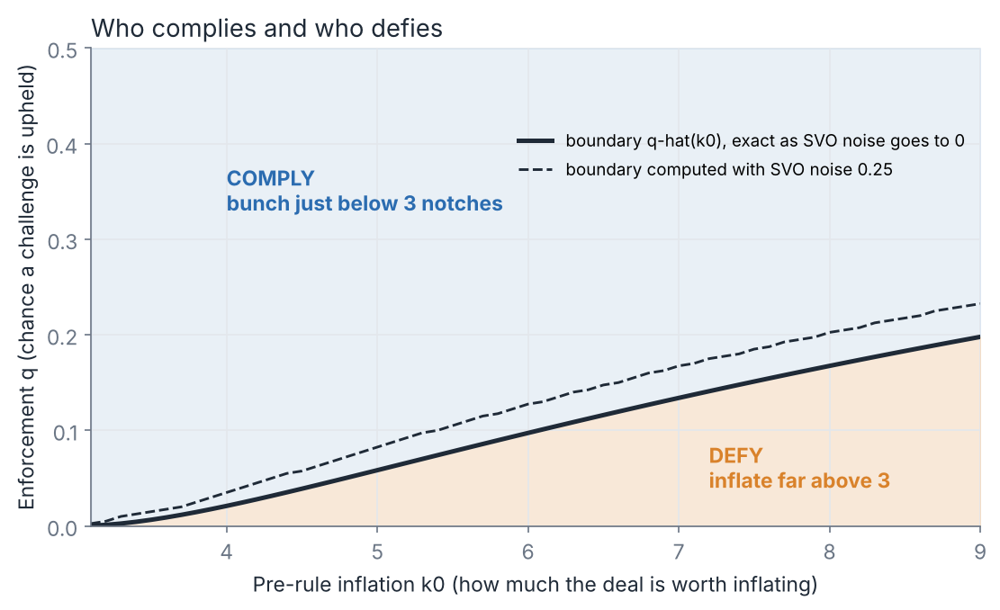
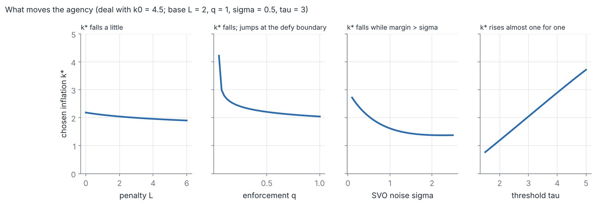
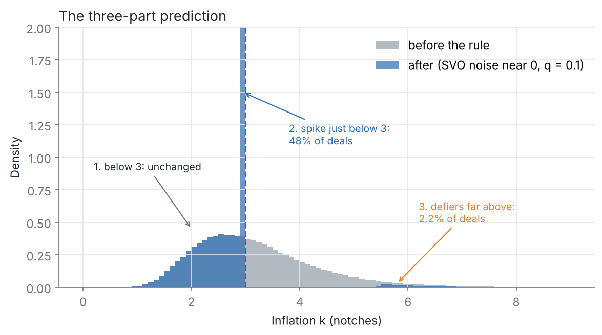

# Stage 1: the agency's choice under the challenge right

*16 Oct 2026. Each result has three parts: the plain-language version, a picture, and the proof. All numbers are checked in `model/julia/stage1.jl`, which writes the data behind the figures to `model/output/`. The figures are drawn by `model/stage1_figures.py`.*

## The set-up, once more

One agency, one bond, all measured in notches. The agency picks inflation $k \ge 0$. The regulator (SVO) sees the bond with noise $\sigma$. A gap of at least $\tau$ notches triggers a challenge, which is upheld with probability $q$.

$$P(k) = q\,\Phi\!\left(\frac{k-\tau}{\sigma}\right), \qquad
U(k) = \underbrace{b k - \tfrac{\gamma}{2}k^2}_{U_0(k):\ \text{payoff with no rule}} \;-\; \underbrace{(b k + L)\,P(k)}_{D(k):\ \text{expected damage}}$$

- **Expected damage** $D(k)$ is what a challenge costs the agency: the fee gain $bk$ it loses plus the penalty $L$, times the chance of a challenge.
- Without the rule the agency picks $k_0 = b/\gamma$.
- We write $z = (k-\tau)/\sigma$ for "how many SVO-noise units the agency sits from the line" ($z<0$ means below it), and $\varphi$ for the standard normal density.
- Throughout: $b, \gamma, \sigma, \tau > 0$, $L \ge 0$, $q \in (0,1]$.

The first-order condition, used repeatedly:

$$U'(k) = b\,(1-P) - (bk+L)\,P' - \gamma k = 0, \qquad P'(k) = \frac{q\,\varphi(z)}{\sigma}.$$

---

## Result 1. The agency's problem always has an answer

**In words.** There is always a best inflation level. It is above zero unless the penalty is large and the SVO is so noisy that even an honest rating risks a challenge.

**Statement.** A maximiser $k^*$ exists. If $b\,(1-P(0)) > L\,P'(0)$, then $k^* > 0$.

**Proof.** $U$ is continuous and $U(k) \le U_0(k) \to -\infty$, so the maximum is reached on a closed interval $[0,\bar k]$. If $U'(0) = b(1-P(0)) - L P'(0) > 0$, a small $k>0$ beats $k=0$. ∎

---

## Result 2. The rule always lowers inflation

**In words.** Whatever the settings, the agency inflates less than it did before the rule. Deals far below the threshold barely change, because the chance of a challenge there is close to zero.

**Statement.** Every maximiser satisfies $k^* < k_0 = b/\gamma$.

**Proof.** $D(k)$ is strictly increasing, since $bk+L$ and $P(k)$ are positive and increasing. For any $k > k_0$ we have $U_0(k) < U_0(k_0)$ and $D(k) > D(k_0)$, so $U(k) < U(k_0)$. So $k^* \le k_0$. At $k_0$ itself, $U'(k_0) = -bP(k_0) - (bk_0+L)P'(k_0) < 0$, so $k_0$ is not a maximum either. ∎

**Check.** On 768 parameter combinations, $k^*$ never exceeds $k_0$ by more than $10^{-6}$, which is solver precision.

---

## Result 3. The safety margin

**In words.** A deal that would have been inflated past 3 notches stops short of the line. How far short depends on the SVO's noise. A sharp SVO lets the agency creep right up to the line. A noisy one keeps it further away.

**Statement (small-noise approximation).** Suppose $k_0 > \tau$ and the agency complies ($k^* < \tau$). As $\sigma \to 0$, $k^* \to \tau$. The margin $m = \tau - k^*$ is approximately

$$m \;\approx\; \sigma\,\sqrt{2\ln\!\left(\frac{q\,(b\tau+L)}{\sqrt{2\pi}\;\sigma\;(b-\gamma\tau)}\right)} .$$

- **The margin shrinks with the SVO's noise, but more slowly than the noise itself.** It behaves like $\sigma\sqrt{\ln(1/\sigma)}$.
- **The margin is wider when enforcement $q$ or the penalty $L$ is larger.**
- **The margin is narrower for more valuable deals** (larger $b-\gamma\tau$). These deals squeeze closer to the line.

**Derivation.** In the comply region $z \to -\infty$ as $\sigma \to 0$, so $P \to 0$ and $k \to \tau$. The first-order condition becomes $b - \gamma\tau \approx (b\tau+L)\,q\,\varphi(z)/\sigma$. Solve for $z = -m/\sigma$. This is an asymptotic approximation, not an exact formula. It is within 10% of the exact margin for $\sigma \le 0.25$ notch and overstates it beyond that (see the figure).

---

## Result 4. Comply or defy

**In words.** When enforcement is weak, a second option appears. The agency can ignore the line, inflate a lot, and accept a small chance of removal. The most valuable deals take that option. So a rarely enforced rule does more than weaken discipline. It splits the market into deals that bunch just below 3 notches and deals that stay far above.

**Statement (limit as $\sigma \to 0$, for a deal with $k_0 > \tau$).** Let $A = b^2/(2\gamma)$ and $C = b\tau - \gamma\tau^2/2$. The agency defies (picks $k^* > \tau$) if and only if $q < \hat q$, where

$$\hat q \;=\; \frac{(2A+L) - \sqrt{(2A+L)^2 - 4A\,(A-C)}}{2A} \;\in\; (0,1).$$

A defying agency picks $k_D = b(1-q)/\gamma = (1-q)\,k_0$. The threshold $\hat q$ rises with the deal's value $k_0$ and falls with the penalty $L$.

**Proof.** As $\sigma \to 0$, $P(k) \to 0$ for $k<\tau$ and $P(k) \to q$ for $k>\tau$.
- **Comply value.** Below the line $U = U_0$. $U_0$ rises up to $k_0 > \tau$, so the best the agency can do below the line is approach $\tau$, which is worth $U_0(\tau) = C$.
- **Defy value.** Above the line $U = b(1-q)k - qL - \tfrac{\gamma}{2}k^2$, which peaks at $k_D = b(1-q)/\gamma$ with value $A(1-q)^2 - qL$.
- **Comparison.** Let $f(q) = A(1-q)^2 - qL - C$. Then $f(0) = (b-\gamma\tau)^2/(2\gamma) > 0$ and $f(1) = -L - C < 0$, since $C > 0$ when $k_0 > \tau$. Also $f'(q) = -2A(1-q) - L < 0$. So $f$ has exactly one root in $(0,1)$, the smaller root of the quadratic $Aq^2 - (2A+L)q + (A-C) = 0$, which is $\hat q$.
- **Consistency.** Where $f \ge 0$ we have $A(1-q)^2 \ge C \ge \gamma\tau^2/2$, which implies $k_D \ge \tau$. So the defy peak really does sit above the line.
- **Comparative statics.** Raising $L$ lowers $f$ everywhere, so $\hat q$ falls. Raising $k_0$ raises $f(q)$ at the root, so $\hat q$ rises. ∎

**Numbers** (with $L = 2$ and $\tau = 3$):

| Deal's pre-rule inflation $k_0$ | $\hat q$ as $\sigma \to 0$ | $\hat q$ computed with $\sigma = 0.25$ |
|---|---|---|
| 4.5 | 0.039 | 0.058 |
| 6.0 | 0.097 | 0.128 |
| 7.5 | 0.151 | 0.185 |

Noise in the SVO's view widens the defy region a little, because it also blunts the threshold.

**Why this matters for the NAIC.**
- A challenge only leads to a meeting that **may** remove filing exemption, and practitioners expect the power to be used rarely. Both point to a low $q$.
- Result 4 says a low $q$ leaves the most valuable deals untouched, and these are exactly the deals the rule was aimed at.

---

## Result 5. What moves the agency (comply regime)

**In words.** Inside the comply regime:
- **The threshold** moves inflation almost one for one: a 4-notch rule lets agencies inflate about one notch more.
- **Enforcement** cuts inflation, until it falls so low that the deal flips to defy.
- **A noisier SVO** cuts inflation, as long as the agency sits more than one noise unit below the line.
- **The agency's own penalty $L$** matters only a little. Losing the fee gain already does most of the work.
- **The deal's value** barely matters. This is what produces bunching.

**Statement.** At an interior comply maximum ($k^* < \tau$, $U''(k^*) < 0$):

| Change | Effect on $k^*$ | Sign of $\partial U'/\partial(\cdot)$ at $k^*$ |
|---|---|---|
| Penalty $L$ ↑ | falls | $-P' < 0$ |
| Enforcement $q$ ↑ | falls | $-b\Phi(z) - (bk+L)\varphi(z)/\sigma < 0$ |
| Threshold $\tau$ ↑ | rises | $\dfrac{q\varphi(z)}{\sigma}\Big(b - \dfrac{(bk+L)\,z}{\sigma}\Big) > 0$ since $z<0$ |
| SVO noise $\sigma$ ↑ | falls if $\lvert z^*\rvert \ge 1$ | $\dfrac{q\varphi(z)}{\sigma}\Big(b z - \dfrac{(bk+L)(z^2-1)}{\sigma}\Big) < 0$ if $z<0$ and $z^2 \ge 1$ |
| Deal value $b$ ↑ | rises (slightly) | $(1-P) - kP' > 0$ |

**Proof.** By the implicit function theorem, $\partial k^*/\partial x = -\,(\partial U'/\partial x)/U''$, and $U'' < 0$ at a maximum. So the sign of $\partial k^*/\partial x$ is the sign of $\partial U'/\partial x$. The derivatives in the table use $\partial z/\partial\tau = -1/\sigma$, $\partial z/\partial\sigma = -z/\sigma$ and $\varphi'(z) = -z\varphi(z)$. For $b$: the first-order condition gives $b(1-P) = (bk+L)P' + \gamma k > bkP'$, so $(1-P) > kP'$. ∎

**Check** (finite differences at $k_0 = 4.5$, $L=2$, $q=1$, $\sigma=0.5$, $\tau=3$): $\partial k^*/\partial L = -0.05$, $\partial k^*/\partial q = -0.22$, $\partial k^*/\partial\sigma = -1.22$, $\partial k^*/\partial\tau = +0.86$, $\partial k^*/\partial k_0 = +0.04$.

---

## Putting it together: the three-part prediction

As the SVO's noise goes to zero, the distribution of inflation across deals has three parts:
1. **Deals that were below 3 notches do not change.**
2. **A spike just below 3,** made up of every deal that was above 3 and complies.
3. **A thinned group of defiers far above 3,** each at $(1-q)\,k_0$.

The figure uses small-agency deals (median pre-rule gap 3 notches) and $q = 0.1$: 48% of deals bunch and 2% defy. With real SVO noise the spike spreads into the hump shown in [MODEL_PLAN.md](MODEL_PLAN.md) (Figure 4).

**What this gives the empirical follow-up.** The size of the spike pins down how many deals comply. The share and position of deals above 3 pin down enforcement $q$. The width of the spike pins down the SVO's noise $\sigma$.

## Next

- **Stage 2:** many deals and two agency tiers, now including the defy group, and the measured-gap distribution with whole notches.
- **Stage 2b:** the agency chooses its own precision (agreed on 16 Oct).
- **Stage 3:** the regulator chooses $\tau$, $q$ and the penalty shape. Result 4 already suggests that **raising $q$ (committing to remove) may matter more than lowering $\tau$**.
